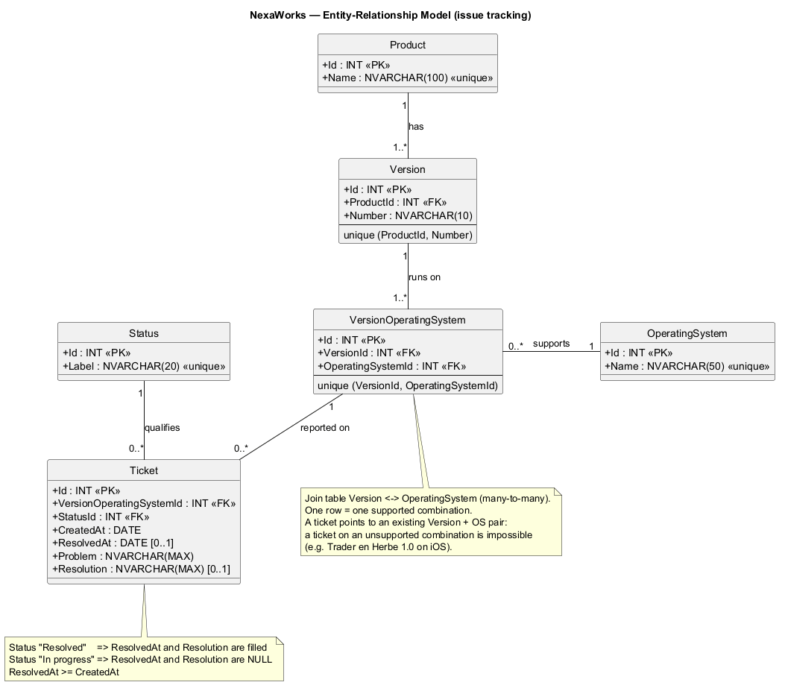

# NexaWorks — Base de données de suivi des problèmes

Base de données relationnelle (SQL Server) qui stocke et suit les problèmes rencontrés sur les produits
NexaWorks, pour chaque version et chaque système d'exploitation, ainsi que leur résolution.

La base est créée en **Code First** avec Entity Framework Core : les entités C# décrivent le modèle,
une migration crée les tables, et des données de test (25 tickets) sont insérées au lancement.

## Modèle entité-association



Source PlantUML : [`docs/mea-nexaworks.puml`](docs/mea-nexaworks.puml)

### Entités

| Entité | Rôle |
|---|---|
| `Product` | Un logiciel NexaWorks (Trader en Herbe, Maître des Investissements…) |
| `Version` | Une version d'un produit (1.0, 1.1, 2.0…) |
| `OperatingSystem` | Un système d'exploitation (Linux, MacOS, Windows, Android, iOS, Windows Mobile) |
| `VersionOperatingSystem` | Une compatibilité : la version X fonctionne sur l'OS Y (un « x » du tableau des produits et versions) |
| `Ticket` | Un problème signalé sur une combinaison version + OS, avec sa résolution éventuelle |
| `Status` | Le statut d'un ticket : « En cours » ou « Résolu » |

### Relations

| Relation | Type | Signification |
|---|---|---|
| Product — Version | one-to-many | Un produit a une ou plusieurs versions ; une version appartient à un seul produit |
| Version — OperatingSystem | many-to-many, via `VersionOperatingSystem` | Une version tourne sur plusieurs OS ; un OS fait tourner plusieurs versions |
| VersionOperatingSystem — Ticket | one-to-many | Un ticket concerne une seule combinaison version + OS |
| Status — Ticket | one-to-many | Un ticket a un seul statut |

### Choix de conception

- **Le ticket pointe vers la combinaison version + OS** (`VersionOperatingSystem`), et non vers la version
  et l'OS séparément : un ticket ne peut concerner qu'une combinaison réellement supportée
  (impossible, par exemple, de créer un ticket pour Trader en Herbe 1.0 sur iOS).
- **Unicités** : nom de produit, nom d'OS, libellé de statut, couple (produit, numéro de version),
  couple (version, OS).
- **Contraintes CHECK sur `Ticket`** :
  - « En cours » ⇒ `ResolvedAt` et `Resolution` sont NULL ; « Résolu » ⇒ les deux sont renseignés ;
  - `ResolvedAt >= CreatedAt`.
- **Suppressions restreintes** : impossible de supprimer une ligne encore référencée
  (par exemple un produit qui a des versions).

## Prérequis

- [.NET SDK 10](https://dotnet.microsoft.com/download)
- SQL Server (instance par défaut `MSSQLSERVER`) démarré
- SQL Server Management Studio (SSMS), pour consulter la base
- LINQPad, pour exécuter les requêtes

## Lancer le projet

1. Cloner le dépôt et ouvrir `P6.slnx` dans Visual Studio.
2. Vérifier la chaîne de connexion dans `P6/appsettings.json` :
   ```
   Server=localhost;Database=NexaWorks;Trusted_Connection=True;TrustServerCertificate=True
   ```
3. Lancer le projet (F5, ou `dotnet run --project P6`).

Au démarrage, le projet :
1. applique les migrations : la base `NexaWorks` et ses tables sont créées si elles n'existent pas ;
2. insère les données de test si la base est vide : 4 produits, 12 versions, 6 OS,
   44 compatibilités et 25 tickets (15 résolus, 10 en cours).

Aucune commande de migration n'est à taper.

## Vérifier les données dans SSMS

Se connecter au serveur `localhost` (authentification Windows), puis exécuter sur la base `NexaWorks` :

```sql
SELECT t.Id, p.Name AS Produit, v.Number AS Version, os.Name AS OS,
       s.Label AS Statut, t.CreatedAt, t.ResolvedAt, t.Problem, t.Resolution
FROM Ticket t
JOIN VersionOperatingSystem vos ON vos.Id = t.VersionOperatingSystemId
JOIN Version v                  ON v.Id = vos.VersionId
JOIN Product p                  ON p.Id = v.ProductId
JOIN OperatingSystem os         ON os.Id = vos.OperatingSystemId
JOIN Status s                   ON s.Id = t.StatusId
ORDER BY t.Id;
```

## Requêtes LINQ (LINQPad)

Les requêtes sont dans [`Queries/TicketSearch.linq`](Queries/TicketSearch.linq), à ouvrir avec
[LINQPad](https://www.linqpad.net/).

1. Dans LINQPad : **Add connection** → *LINQPad automatic driver* → SQL Server, serveur `localhost`,
   authentification Windows, *Trust server certificate* coché, base `NexaWorks`.
2. Ouvrir `Queries/TicketSearch.linq`, sélectionner cette connexion, puis **F5**.

Une seule requête paramétrée, `Search`, couvre toutes les demandes : le statut (en cours ou résolu)
est obligatoire ; le produit, la version, la période (sur la date de création, bornes incluses) et
les mots-clés (tous requis, dans la description du problème) ne sont ajoutés que s'ils sont renseignés.
Chaque appel de `Search` en haut du fichier correspond à une demande et affiche son résultat ;
l'onglet **SQL** de LINQPad montre l'unique `SELECT` envoyé à SQL Server.

## Structure du projet

```
P6/
├── Models/        Entités C#, une par entité du modèle
├── Data/
│   ├── NexaWorksContext.cs   DbContext : tables, relations, unicités, contraintes
│   └── SeedData.cs           Données de test (produits, versions, compatibilités, tickets)
├── Migrations/    Migration InitialCreate générée par EF Core
└── Program.cs     Application des migrations et du seed au démarrage
Queries/           Requêtes LINQ (LINQPad)
docs/              Modèle entité-association (PNG, SVG, source PlantUML)
```

## Technologies

- ASP.NET Core 10
- Entity Framework Core 10 (SQL Server)
- SQL Server 2025
